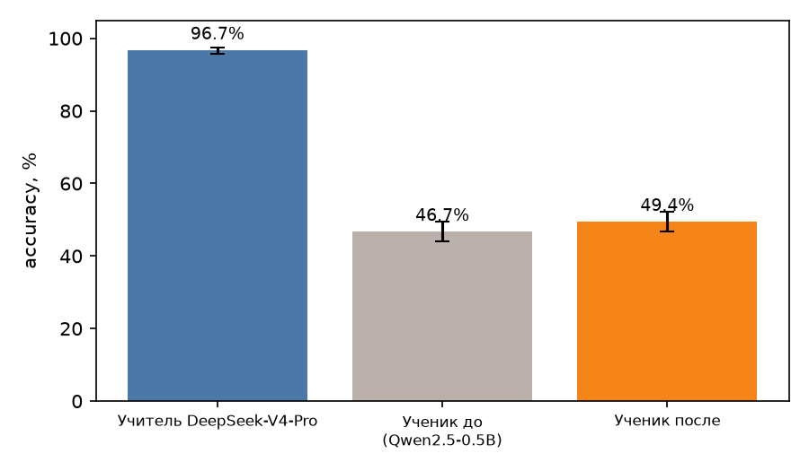
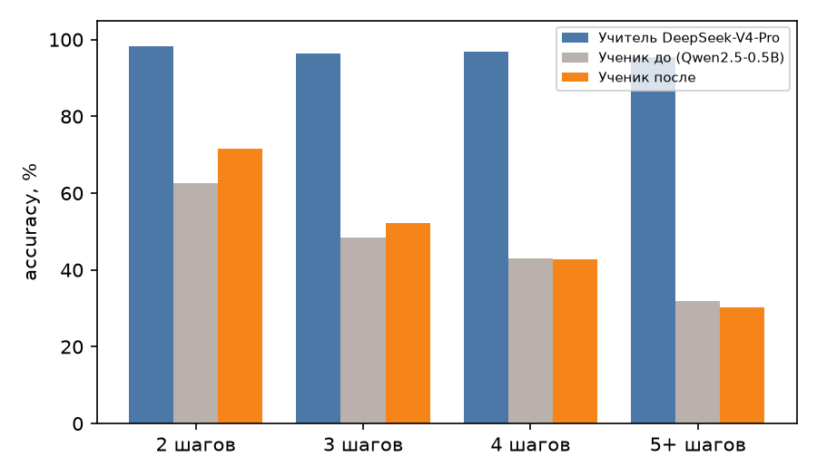
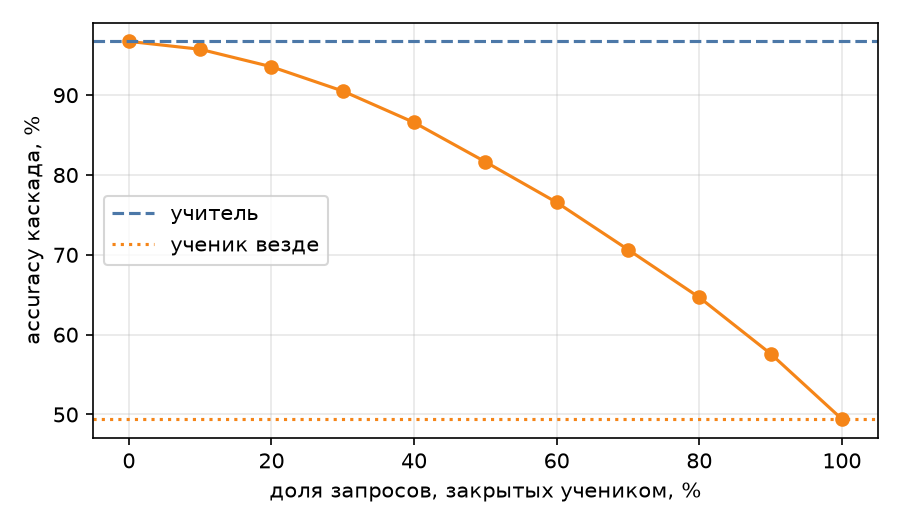
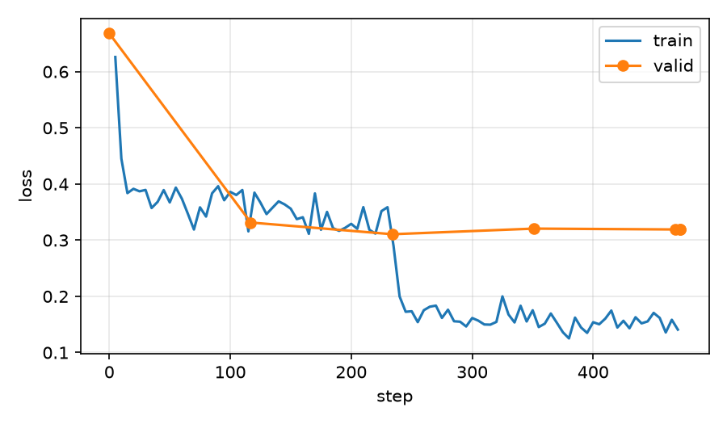

# Дистилляция: DeepSeek-V4-Pro → Qwen2.5-0.5B на школьных задачах GSM8K

Задача: решить текстовую арифметическую задачу и записать рассуждение по шагам. Учитель — `deepseek-v4-pro` (API, thinking выключен, чтобы рассуждение было видимым текстом). Ученик — `Qwen/Qwen2.5-0.5B-Instruct` + LoRA. Тест — весь официальный test-сплит GSM8K, 1319 задач.

Три варианта: ученик до обучения, ученик после, учитель. Сравниваются точность, скорость и цена запроса.

**Главный вывод:** дистилляция сделала ученика в ~20 раз дешевле учителя за запрос, но качества не догнала: **49.4% против 96.7% у учителя** (ученик до обучения — 46.7%). Выигрыш от обучения по точности небольшой и по всем 1319 задачам статистически не значим (+2.7 п.п., p = 0.076); заметно изменился формат (36% → 99%) и длина ответа (252 → 120 токенов). Заменять учителя ученик может только на лёгких задачах или в каскаде; как самостоятельная замена он не годится.

## Почему эта задача

- **Маленькая модель уступает большой.** Qwen2.5-0.5B-Instruct в моём замере решает 46.7% GSM8K, учитель — 96.7%. Разрыв есть, и его можно закрывать данными.
- **Проверяется автоматически.** Ответ — число, сравнивается с эталоном. Никакого LLM-судьи.
- **Навык, а не знания.** В [дне 8](../fine_tuning_limits) на малых данных знания не усваивались, формат и стиль — да. Умение рассуждать по шагам в стиле учителя — навык, его дистилляция имеет смысл. Мексиканскую «Mexamen» из дня 7 для этого брать нельзя: там упирается в факты.
- **Цена учителя считается честно.** API отдаёт число токенов, прайс опубликован.

Ограничение: GSM8K публичный, модели Qwen могли видеть его при обучении (загрязнение возможно, проверить не могу). Это влияет на уровень «ученика до», но не на сравнение до/после на одном наборе.

## Один и тот же запрос для всех

```
<текст задачи>

Solve the math problem step by step. Write the reasoning as short plain-text steps (no markdown, no LaTeX). The last line must be exactly: Answer: <number>
```

Одинаковый для учителя, ученика до и ученика после (`common.build_prompt`). Так разница между «до» и «после» — только веса, а не промпт.

- **Верно** — число в ответе равно эталону (`common.parse_answer`). Парсер мягкий: `Answer: $18`, `\boxed{18}`, `#### 18`, «answer is 18» или, в крайнем случае, последнее число в тексте. Иначе базовую модель штрафовали бы за стиль.
- **Строгий формат** — последняя строка ровно `Answer: <число>`, и это единственное `Answer:` в тексте. Считается отдельно.

## Сбор и чистка данных учителя

### Выбор вопросов (`select_questions.py`)

- **test** — все 1319 задач официального test-сплита. В обучение не попадают.
- **train** — случайные 4000 из 7473 задач train-сплита (seed 42).
- **Защита от утечки.** Из train-пула убраны задачи, похожие на тестовые: совпадение после нормализации или Жаккар по словесным 6-граммам ≥ 0.4. Убрано 2 (две «поездные» задачи с другими числами). Дальше в train/valid тест не попадает ни в каком виде.

### Что спросили у учителя (`teacher.py`)

- Температура 0. Если ответ не совпал с эталоном или формат нарушен — до 2 повторов при температуре 0.7 (иначе в данных остались бы только лёгкие задачи).
- Сырые ответы хранятся как пришли (`data/teacher_train.jsonl`, `data/teacher_test.jsonl`): текст, `finish_reason`, usage, время запроса.
- Всего 4315 запросов на 4000 вопросов; 1319 запросов на test.

### Фильтры (`filter_data.py`)

Берётся первая попытка, прошедшая все проверки:

| Проверка | Что отсекает |
|---|---|
| finish | ответ обрезан по `max_tokens` |
| format | последняя строка не `Answer: <число>` |
| gold | число не равно эталону GSM8K |
| language | иероглифы, кириллица |
| markdown | `**`, LaTeX, заголовки, бэктики |
| length | короче 30 или длиннее 1200 символов |
| arith | в тексте есть равенство `a op b = c` с неверным результатом (верный итог через неверный шаг — плохой пример) |
| repeat | дословно повторяющаяся строка |

| Результат | Задач |
|---|---|
| Отправлено учителю | 4000 |
| Прошла с первой попытки | 3815 |
| Спасено повтором (T=0.7) | 46 |
| **Оставлено** | **3861** (96.5%) |
| Отброшено | 139: gold 119, repeat 10, format 5, length 3, markdown 1, finish 1 |
| → train / valid | **3761** / 100 (valid для val loss, не для оценки) |

Вклад по числу шагов в эталонном решении у оставленных и отброшенных примерно одинаков (отброшено 2.8% у двухшаговых и 5.1% у пятишаговых и длиннее) — перекоса в сторону лёгких задач нет, но трудные отваливаются чуть чаще.

### Ручной просмотр (`data/review_sample.md`)

Прочитал 30 случайных оставленных примеров и 25 отброшенных.

- **Оставленные, 30 из 30:** ответ и арифметика верны. В двух (`train7435`, `train3448`) рассуждение лишнее или натянутое при верном итоге; оставил — отличить это автоматически нечем.
- **Отброшенные по gold (12 из 25 я разобрал внимательно):** в основном ошибки учителя, а также двусмысленные условия («twice more», 1 hour = 1000 mg) и, судя по всему, неверные эталоны GSM8K (`train1052`: по условию ответ 30, в эталоне 25; `train1081`: 1060 против 2460). Такие задачи ушли из-за несогласия с эталоном — это консервативно, но один-два правильных примера могли быть потеряны. Эталон GSM8K не идеален (известный шум порядка 1–2%).
- **Проверка арифметики.** Первая версия нашла 19 «ошибок», все 19 оказались ложными срабатываниями самого парсера (цепочки `M/2 − 14`, смешанные дроби `16 1/2`, деление с остатком, потеря знака). Исправил парсер (`common.bad_equations`). После исправления **ни одной реальной арифметической ошибки в верных по итогу решениях учителя не нашлось**: эта проверка у меня пока ничего не отсекла. Она остаётся как страховка, но пользы её в этом прогоне я не доказал.

## Учитель на тесте (уже измерено)

| | Значение |
|---|---|
| Верно | **1276 / 1319 = 96.7%** |
| Строгий формат | 99.8% |
| По числу шагов (2 / 3 / 4 / 5+) | 98.2% / 96.5% / 97.0% / 95.4% |
| Ср. токенов: вход / ответ | 100 / 98 |
| Медианная задержка запроса | 1.74 с (8 параллельных запросов) |
| Цена по прайсу, вход + выход | $0.68 за 1319 запросов по пиковому тарифу ($0.00052 за запрос), вдвое меньше вне пика |
| Цена данных для обучения | $2.26 по пиковому тарифу (4315 запросов); фактически платил вне пика — суббота UTC, примерно половина |

## Обучение (`train_lora.py`)

Модель — `Qwen/Qwen2.5-0.5B-Instruct`, LoRA r = 64, alpha = 128, dropout 0.05, все линейные слои. 3761 пример, 2 эпохи, батч 8 × 2 = 16, lr 2e-4 cosine, лосс только по токенам ответа, максимум 640 токенов, Colab T4 (fp16). Ученик учится на тех же текстах, которые дал учитель, включая формат `Answer: N`.

## Скорость и цена: как считаю

- **Учитель:** токены и время — из ответов API; цена по прайсу `deepseek-v4-pro` за 1M токенов: вход 1.32 $ (кэш 0.044 $), выход 3.96 $ в пик; вдвое меньше вне пика.
- **Ученик:** пропускная способность на T4 в пакетном режиме (батч 48), цена = аренда GPU / запросов в секунду. Аренду T4 принимаю **0.35 $/час** (список GCP; Colab дешевле, поэтому оценка осторожная). Задержка одного запроса — отдельным замером при batch = 1 на 20 задачах.
- **Разовые затраты:** данные учителя + GPU-время обучения, окупаемость = разовые затраты / (цена учителя − цена ученика за запрос).
- Сравнение условное: учитель — облачный API с очередью и сетью, ученик — собственный GPU без сети.

## Где ученик заменяет учителя

`score.py` считает:
- точность по числу шагов в эталонном решении (2, 3, 4, 5+);
- матрицу «учитель / ученик» на одних и тех же задачах (оба верно / только один / оба неверно) и знаковый тест;
- **каскад**: ученик отвечает, если уверен (средний logprob токенов ответа, считается teacher-forcing'ом после генерации), иначе вопрос уходит учителю. Показывает, какую долю запросов можно отдать ученику при какой точности и цене. AUROC уверенности показывает, годится ли logprob как сигнал.

## Как воспроизвести

```bash
mkdir -p data/raw && for s in train test; do curl -sL -o data/raw/gsm8k_$s.jsonl \
  https://raw.githubusercontent.com/openai/grade-school-math/master/grade_school_math/data/$s.jsonl; done
python select_questions.py                 # data/test.jsonl, data/train_questions.jsonl
export DEEPSEEK_API_KEY=...
python teacher.py test; python teacher.py train     # data/teacher_*.jsonl (~$3 по пиковому прайсу)
python filter_data.py                      # data/train.jsonl, valid.jsonl, filter_report.json, review_sample.md
python build_notebook.py                   # colab_distill.ipynb (данные внутри, 1.3 МБ)
# Colab: T4 -> Run all -> скачать results.zip -> распаковать в results/
python score.py results/                   # comparison.md, answers.md, summary.json, графики
```

Проверка без GPU: `train_lora.py` и `generate.py` прогнаны на CPU (24 примера, 6 задач) — только чтобы убедиться, что код работает; качество на таких объёмах ничего не значит.

## Результаты

Адаптер (141 МБ) и `results.zip` в репозиторий не включены. Тест: 1319 задач, не входящих в обучение; greedy, `max_new_tokens = 512`. Ответы бок о бок — `results/answers.md`, цифры — `results/comparison.md`, `results/summary.json`. Обучение: Tesla T4, 472 шага, 15.2 мин, пик памяти 9.95 ГБ, 35.2 млн обучаемых параметров из 529 млн (6.7%).

### Качество



| Система | Верно | Accuracy | 95% CI | Строгий формат | Обрезано | Ср. токенов ответа |
|---|---|---|---|---|---|---|
| Учитель DeepSeek-V4-Pro | 1276/1319 | **96.7%** | 95.6–97.6% | 100% | 0% | 98 |
| Ученик до | 616/1319 | **46.7%** | 44.0–49.4% | 36% | 3.6% | 252 |
| Ученик после | 652/1319 | **49.4%** | 46.7–52.1% | 99% | 0.7% | 120 |

Парные сравнения (одни и те же задачи, точный знаковый тест):

| Сравнение | Оба верно | Только первый | Только второй | Оба неверно | p |
|---|---|---|---|---|---|
| ученик до → ученик после | 440 | 176 | 212 | 491 | 0.076 |
| ученик после → учитель | 641 | 11 | 635 | 32 | < 0.001 |

- **Что дала дистилляция.** Точность +2.7 п.п., но интервалы до и после пересекаются, а парный тест на границе (p = 0.076): 212 задач стали решаться, 176 перестали. Однозначного улучшения точности я не показал. Надёжно изменились стиль и цена: строгий формат 36% → 99%, ответ вдвое короче (252 → 120 токенов), обрезаний по лимиту 48 → 9.
- **Оговорка про базу.** 48 ответов базы упёрлись в лимит 512 токенов и засчитаны неверными (до 3.6 п.п.); формат ответа базе не вредит — парсер мягкий. Среди ответов базы со строгим форматом верно 51% (479 шт.), среди остальных 44% (840 шт.); часть этой разницы может быть от неточного разбора нестрогих ответов.
- **Учитель.** 635 задач решает только он, 11 — только ученик, 32 не решает никто. Из 43 ошибок учителя ни одной с неверным равенством в тексте: они логические или из-за шума эталона.

### По сложности



Число шагов — в эталонном решении GSM8K.

| Шагов | Задач | Учитель | Ученик до | Ученик после | Ученик до → после (только до / только после, p) |
|---|---|---|---|---|---|
| 2 | 326 | 98% | 63% | **71%** | 31 / 60, p = 0.003 |
| 3 | 371 | 96% | 49% | 52% | 49 / 63, p = 0.22 |
| 4 | 297 | 97% | 43% | 43% | 44 / 43, p = 1.0 |
| 5+ | 325 | 95% | 32% | 30% | 52 / 46, p = 0.61 |

Значимый прирост только на двухшаговых задачах (63% → 71%). Начиная с 4 шагов обучение ничего не изменило. Учитель при этом держит 95–98% на всех уровнях: его точность от сложности почти не зависит, ученика — сильно. По величине ответа: ответ ≥ 1000 — ученик после хуже базы (31% против 39%, 131 задача, значимость не проверял). Это единственный срез, где тюн похож на ухудшение.

### Скорость и цена

| | Учитель (API) | Ученик до | Ученик после |
|---|---|---|---|
| Медианная задержка одного запроса | **1.7 с** | 8.8 с | 4.5 с |
| Токенов/с, один запрос | 56 | 28 | 27 |
| Пропускная способность на T4 (пакет 48) | — | 2.23 запр/с | 3.80 запр/с |
| $ за 1000 запросов | 0.52 (пик) / 0.26 (вне пика) | 0.044 | **0.026** |
| $ за 1000 верных ответов | 0.54 | 0.093 | **0.052** |

- **Дешевле в 20 раз за запрос** (0.52 $ → 0.026 $ за 1000), в 10 раз за верный ответ (0.54 $ → 0.052 $) — потому что точность ученика вдвое ниже. Против цены вне пика (0.26 $) выигрыш 10× и 5×.
- **Скорость.** Пропускная способность ученика выросла на 70% (2.23 → 3.80 запр/с), но только из-за вдвое более коротких ответов: скорость генерации на токен та же (28 против 27 ток/с). Ученик на T4 в одиночном запросе **медленнее учителя**: 4.5 с против 1.7 с. Выигрыш в скорости есть только в пакетной нагрузке.
- **Окупаемость.** Разовые затраты $2.35 (данные учителя $2.26 по пиковому тарифу + обучение $0.09) окупаются разницей в цене через ~4 800 запросов — если устраивает точность ~50%.
- **Допущения.** GPU 0.35 $/час (список GCP, Colab дешевле) и полная загрузка в пакетном режиме; дежурство GPU без нагрузки и эксплуатацию не считал. Учитель — удалённый сервис с сетью и очередью, ученик — локальный GPU: сравнение условное.

### Где ученик заменяет учителя, а где ещё ошибается

**Ошибается:**
- Задачи в 4 шага и длиннее: 43% и 30%, обучение не помогло.
- Большие числа (ответ ≥ 1000): 31%.
- Условия с «подвохом» — ученик теряет часть условия или неверно понимает проценты. Пример `test0`: «ест 3 яйца и печёт 4 маффина» — ученик вычел только 3 и получил 26 вместо 18. Пример `test2`: «стоимость выросла на 150%» — ученик принял 150% за итоговую цену. Ошибка в рассуждении, а не в арифметике. Ещё примеры — `results/answers.md`.
- Арифметику ученик тоже считает неверно: в 110 из 667 неверных ответов (16%) есть неправильное равенство в тексте (у базы 37 из 703, у учителя 0 из 43). Парсер видит только простые равенства, поэтому это нижняя оценка.

**Может заменить:**
- Двухшаговые задачи — 71% против 98%: не замена, но уже рабочий уровень для черновика.
- Каскад: ученик отвечает, если уверен (средний logprob токенов, AUROC уверенности 0.757 — сигнал есть, но слабый), иначе вопрос уходит учителю.



| Доля ответов ученика | Accuracy ученика на этой доле | Accuracy каскада | $ за 1000 запросов |
|---|---|---|---|
| 0% (только учитель) | — | 96.7% | 0.52 |
| 10% | 88.6% | 95.8% | 0.49 |
| 20% | 82.6% | 93.6% | 0.44 |
| 30% | 77.8% | 90.5% | 0.39 |
| 50% | 67.6% | 81.7% | 0.28 |
| 100% (только ученик) | 49.4% | 49.4% | 0.03 |

На всём наборе нет точки, где каскад сравнялся бы с учителем: уже на 10% ответов ученика теряется 0.9 п.п. точности ради экономии 6%. Типичная цена: 20% трафика ученику → −3.1 п.п. и −15% стоимости; 50% → −15 п.п. и −46%. Порог по уверенности я не подбирал на отдельной выборке, кривая считана на тех же тестовых задачах, так что на новых данных она может выглядеть иначе.

### Переобучение



Val loss 0.668 (до) → 0.331 (шаг 117) → 0.311 (234) → 0.321 → 0.319 (конец), train loss к концу ~0.16. Основное падение — за первую половину эпохи, дальше val loss стоит на месте при падающем train loss; значит, хватило бы, вероятно, заметно меньшего числа шагов (не проверял).

### Почему так мало, и что я не проверил

Это гипотезы, проверок не делал:
- Учитель пишет предельно короткие шаги (~98 токенов). Для модели на 0.5 млрд параметров это, возможно, слишком мало «места для вычислений»: ответ стал вдвое короче, а ошибок в многошаговых задачах не стало меньше. Развёрнутые рассуждения (учитель с включённым thinking) могли бы дать больше.
- Данные: 3.7 тысячи примеров, 2 эпохи; доступно было ещё ~3.5 тысячи задач из train. Модели Qwen и без того обучены на подобных задачах (возможное загрязнение), так что «новому» научить сложнее.
- Один прогон, один seed, одна конфигурация LoRA; различия порядка 2–3 п.п. на 1319 задачах — на границе шума.
- Не пробовал ученика побольше (1.5B), тут `--model` в скриптах меняется одной строкой.
