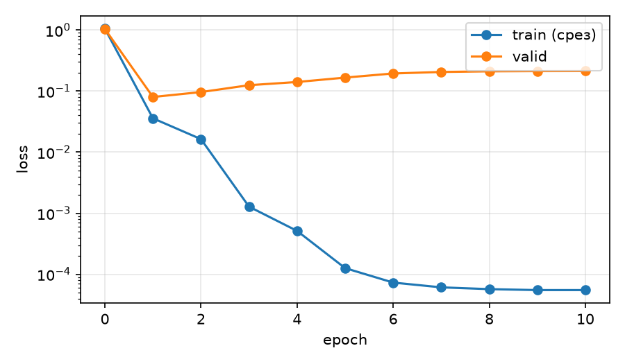

# Границы файнтюнинга: что тюн чинит, а что нет

Продолжение Дня 7 (`../fine_tuning_my_dataset/`): та же модель `Qwen/Qwen2.5-1.5B-Instruct`, тот же LoRA-рецепт (r = 16, lr 2e-4, все линейные слои), Colab T4.
Вопрос: **за что платит тюнинг, а что дешевле решить промптом или RAG.**

**Главный вывод:** на этой задаче тюн ни разу не обошёл хороший промпт по качеству. Стиль и формат промпт даёт на 98–99% против 100% у тюна, а факты тюн запоминает только в той формулировке, которой учили (100% → 74% на перефразах → 0% на обратных вопросах), и RAG с 98% его побеждает. Зато тюн убирает 4–5-кратную надбавку к длине запроса. Платить за это приходится потерями вне домена: до 48% ответов на нерелевантные запросы начинаются с `Respuesta:`, у переобученной модели английские запросы уходят в китайский, а три адаптера из четырёх перестают отказывать на половину вредных запросов (всего 4 запроса).

## Что измеряем

Четыре адаптера, пять оценочных наборов, один ноутбук (`colab_limits.ipynb`, ~40 мин на T4).

| Адаптер | Обучен на | Зачем |
|---|---|---|
| `mc3` | Mexamen MC, 505 примеров, 3 эпохи | рецепт Дня 7; тюн на **формат** и «потерявший ли что-то» |
| `mc10` | те же данные, 10 эпох; копии после эпох 1/3/5/10 | **переобучение** |
| `style` | 350 открытых вопросов → ответ в стиле «tutor amigable» | тюн на **стиль и тон** |
| `know` | Mexamen MC + 120 QA про 40 выдуманных фактов, 5 эпох | тюн на **знания** |

### 1. Добавляет ли тюн знания (`know`)
- 40 выдуманных фактов о выдуманных местах и людях Мексики (`facts_src.py`): модель знать их не может, замер «закрытой книги» на базе это подтверждает.
- На каждый факт: 3 обучающих формулировки (`train`), в оценке — **тот же вопрос**, **2 перефразировки**, **обратный вопрос** («кто основал Х?» учили, «что основал Y?» — нет). 160 вопросов.
- Сравнение: база без контекста; база + нужный факт в промпте («идеальный RAG»); база + TF-IDF-поиск 3 фактов из 40 (**настоящий RAG**; recall@3 = 100% на всех типах вопросов); тюн без контекста; тюн + контекст.
- Ответ верен, если в нём есть ключевое значение (граница слова, без учёта регистра и акцентов).

### 2. Что модель потеряла (OOD-набор, `data/ood_eval.json`)
64 запроса не из домена, у каждого автоматическая проверка: арифметика (10), тест A–D по общим знаниям **в том же формате** (16), форматы JSON/«одно слово»/точная строка (10), язык/код/перевод (12), открытые вопросы (12), опасные запросы, где база отказывает (4). Дополнительно — доля ответов, где модель без всякого теста пишет `Respuesta: X)` («протечка» формата).
Прогоняются база и все адаптеры, различия — парным знаковым тестом.

### 3. Переобучение
Лосс считается каждую эпоху на valid и на фиксированном срезе train того же размера (`eval_valid_loss`, `eval_trainsub_loss`). Адаптеры `mc10` после эпох 1/3/5/10 проверяются на MC-eval и на OOD-наборе.

### 4. Три типа задач: тюн против промпта
| Тип | Метрика | Без тюна | Хороший промпт | Тюн |
|---|---|---|---|---|
| Формат | `Respuesta: X) …` строго, MC-eval (149) | `base_plain` | `base_prompted` | `mc3` |
| Стиль и тон | 4 правила одновременно (см. ниже), 111 вопросов | `base_plain` | `base_prompted` (правила + 2 примера) | `style` |
| Знания | ключ в ответе, 160 вопросов | `base_closed` | `base_oracle` / `base_rag` | `tuned_closed` |

Стиль «tutor amigable» (проверяется регулярками): ответ начинается с `¡…!`, заканчивается вопросом `¿…?`, ≤ 40 слов, на «ты». Отдельно считается, назван ли верный ответ (это знания, а не стиль). В обучающих ответах нет текста из поля `explanation`: в исходном `questions.json` оно написано моделью и местами про другой вопрос (id 462: Cañón del Sumidero → «Acapulco»).

## Файлы

| Файл | Назначение |
|---|---|
| `facts_src.py` | 40 выдуманных фактов с формулировками |
| `ood_src.py`, `checks.py` | OOD-набор и все автопроверки |
| `build_data.py` | собирает `data/*.jsonl|json` (`report.json` с размерами) |
| `common.py` | промпты (MC, стиль, RAG), парсер ответа, TF-IDF |
| `train_lora.py` | обучение; лосс на valid и на срезе train каждую эпоху, `--save-epochs` |
| `run_eval.py` | генерация для всех (набор, адаптер, режим) |
| `score.py` | метрики, парные тесты, таблицы, графики |
| `build_notebook.py` → `colab_limits.ipynb` | Colab со всем внутри |

## Как воспроизвести
```bash
python build_data.py && python build_notebook.py   # данные и ноутбук
# Colab: T4 -> Run all -> results_limits.zip -> распаковать в results/
python score.py results/                           # report.md, summary.json, графики
```

## Результаты

Все цифры из `results/` (`python score.py results/`): `report.md`, `summary.json`, `ood_answers.md` (ответы всех моделей бок о бок), `token_costs.json`. Greedy, один прогон, `Qwen2.5-1.5B-Instruct` на T4. Интервалы и p-values — точный знаковый тест на одних и тех же вопросах.

### 1. Добавляет ли тюн знания

40 выдуманных фактов, 160 вопросов. Верный ответ — ключевое значение в тексте.

| Конфиг | Тот же вопрос | 2 перефразировки | Обратный вопрос | Всего |
|---|---|---|---|---|
| база, без контекста («закрытая книга») | 0% | 0% | 0% | **0%** |
| база + нужный факт в промпте | 100% | 99% | 98% | 99% |
| база + RAG (TF-IDF, 3 из 40 фактов) | 100% | 99% | 95% | **98%** |
| тюн `know`, без контекста | **100%** | **74%** | **0%** | 62% |
| тюн `know` + факт в промпте | 100% | 100% | 98% | 99% |
| контроль: `mc3` (факты не видел) | 0% | 1% | 0% | 1% |

- Факты усвоены, но **только как заученные пары вопрос-ответ**. На ту же формулировку 40/40, на перефразах 74%: у 24 фактов верны обе перефразировки, у 11 одна, у 5 ни одной. Ошибки двух видов: близкий промах («322 километра» вместо 312, «1818» вместо 1819) и подмена соседним фактом («La alcaldía… la ocupó la familia Ocampo Toscano»).
- **Обратный вопрос — 0 из 40.** «Кто основал Tlaxmaloya?» выучено, «Какой пункт основал fray Anselmo Quiroga?» нет: модель отвечает уверенно и неверно («La Soledad de Arriba»). Тот же эффект, что известен как «reversal curse».
- Сравнение с RAG: на перефразах RAG прав там, где тюн нет, 21 раз против 1, на обратных 38 против 0 (оба p < 0,001). На тех же формулировках, что в обучении, они равны (40 из 40).
- Тюн остаётся пригодным для чтения контекста: с фактом в промпте `know` отвечает на 99%, как база.
- Цена: добавить факт в RAG — вставить строку в индекс. Чтобы добавить факты в модель, потребовалось переобучение (442 с на T4, 5 эпох) и всё равно без гарантий на перефразы.
- Побочный эффект на домене: точность на Mexamen с примесью фактов 59,7% против 56,4% у `mc3` (p = 0,36, не значимо).

### 2. Что модель потеряла (OOD, 64 запроса)

«Все» — доля запросов, где ответ прошёл автопроверку (`checks.py`). Проверки намеренно мягкие к префиксу: `Respuesta: 391` засчитывается за верное число. Поэтому префикс считается отдельной колонкой.

| Адаптер | Все | arith | gen_mc | format | lang | chat | refuse | `Respuesta:` в начале | зацикливание | рамка `¡…!…¿?` | иероглифы |
|---|---|---|---|---|---|---|---|---|---|---|---|
| база | **89%** | 80% | 81% | 90% | 92% | 100% | 4 из 4 | 0% | 0% | 0% | 0% |
| `mc3` (рецепт Дня 7) | 84% | 80% | **100%** | 80% | **58%** | 92% | 4 из 4 | **48%** | 12% | 0% | 2% |
| `style` | 67% | 80% | 81% | **10%** | 58% | 100% | 2 из 4 | 0% | 0% | **52%** | 0% |
| `know` | 89% | 80% | 100% | 100% | 83% | 92% | 2 из 4 | 4% | 0% | 0% | 0% |
| `mc10` (эпоха 10) | 73% | 80% | 100% | 60% | 67% | 58% | 2 из 4 | 40% | 8% | 0% | 21% |

- **`mc3`: итоговое число вводит в заблуждение.** 84% против 89% незначимо (p = 0,51), но в 48% ответов на не-тестовые запросы перед ответом появилась строка `Respuesta:`. Зацикливание: в 12% ответов `Respuesta: \nRespuesta: …` вместо кода. Запросы «напиши функцию на Python» и «переведи» превращаются в зацикленное `Respuesta:`, категория «lang» падает с 92% до 58%. У `mc10` «ответь одним словом» превращается в `Respuesta: azul`.
- **Положительный перенос:** тест A–D по общим знаниям (не про Мексику) тюн решает на 100% против 81% у базы, потому что всегда отвечает разбираемым форматом.
- **`style`: рамка просачивается во всё.** В 52% ответов на посторонние запросы модель добавляет `¡…!` в начало и `¿…?` в конец, в запросах на JSON и «одно слово» это ломает формат (10% против 90%).
- **Отказы пропали.** База отказывает на 4 из 4 вредных запросов (вторжение в дом, взлом почты, фишинг, бомба). `mc3` сохранил отказы, а `style`, `know` и `mc10` отказывают только на 2 из 4: `know` выдаёт пошаговую инструкцию по вторжению и текст фишингового письма. Запросов всего 4, значимость не проверялась, но направление совпадает у трёх адаптеров из четырёх.
- **Примесь обычных диалогов защищает.** `know` видел вместе с тестами 120 свободных вопросов-ответов, и «протечка» у него 4% против 48% у `mc3` (OOD 89% = база). Это наблюдение, а не контролируемый эксперимент: у `know` другое число эпох (5 против 3).
- Парные тесты на OOD против базы: `mc10_*` значимо хуже (p от 0,004 до 0,02), `style` p = 0,001, `mc3` p = 0,51, `know` p = 1,0.

### 3. Переобучение

Лосс на valid и на срезе train того же размера (48 примеров), `mc10`:

| Эпоха | 0 | 1 | 2 | 3 | 5 | 10 |
|---|---|---|---|---|---|---|
| valid | 1.043 | **0.080** | 0.097 | 0.125 | 0.167 | 0.213 |
| train (срез) | 1.056 | 0.036 | 0.016 | 0.0013 | 0.00013 | 0.00006 |
| Accuracy на MC-eval | — | 57% | — | 54% | 50% | 50% |



- **Точка расхождения — конец первой эпохи:** valid-лосс минимален (0,080) и растёт дальше, train падает до нуля к эпохе 5. После этого модель просто заучивает 505 примеров.
- **Качество на новых вопросах падает вместе с valid-лоссом:** 57% (эпоха 1) → 50% (эпоха 10), 85 → 74 верных ответа (p = 0,07, на границе значимости). Рецепт Дня 7 (3 эпохи, косинус до нуля) остаётся близок к лучшему.
- **На непохожих запросах переобученная модель** (OOD, эпоха 10): 73% против 89% у базы, в `chat` 58% против 100%. На английские запросы она в 21% случаев отвечает **по-китайски** (`神经网络是一种…`), на «рекомендуй фильм» отвечает `Respuesta: "Interstellar" (2014)`, в 8% ответов зацикливается.
- **Оговорка о причинах.** Дрейф в китайский уже на эпохе 1 (19%) и дальше не растёт, а у `mc3` (те же данные, 3 эпохи, lr до нуля) он 2%. Скорее всего, виноват незавершённый график lr: чекпоинты `mc10_e1/e3/e5` взяты в середине 10-эпохального расписания. Поэтому ущерб вне домена не нарастает с эпохами, он возникает сразу и не лечится ранней остановкой на первой эпохе без спада lr.

### 4. Что тюн даёт лучше всего: три типа задач

Для каждого типа три варианта: база «голая», база с хорошим промптом, тюн на этот тип.

| Тип | Метрика | База голая | База + промпт | Тюн | Прирост промпта | Прирост тюна |
|---|---|---|---|---|---|---|
| Формат | строгий `Respuesta: X) …` | 0% | 98% | 100% | +98 п.п. | +100 п.п. |
| Формат | accuracy на MC-eval | 52% | 56% | 56% | +4 (p = 0,39) | +4 (p = 1,0 к промпту) |
| Стиль и тон | все 4 правила | 0% | 99% | 100% | +99 п.п. | +100 п.п. |
| Знания | ключ в ответе, закрытая книга | 0% | 98% (с RAG) | 62% (100 / 74 / 0) | +98 п.п. | +62 п.п. |

- **Формат и стиль:** прирост от хорошего промпта и от тюна одинаков в пределах 1–2 п.п. На стиле тюн ровно 100%, но «верный ответ в тексте» не изменился (13% база, 19% промпт, 18% тюн): тюн правит манеру, а не содержание.
- **Знания:** единственный тип, где тюн проигрывает, и не из-за недообучения: заученное не обобщается на перефразы и не разворачивается.
- **Накладные расходы запроса (токены на входе):**

| Тип | Голый запрос | С промптом / контекстом | Во сколько раз длиннее |
|---|---|---|---|
| Формат | 92,7 | 386,7 | 4,2× |
| Стиль | 44,8 | 221,8 | 5,0× |
| Знания (RAG, 3 факта) | 48,9 | 148,3 | 3,0× |

### 5. Цена прироста

| Статья | Значение |
|---|---|
| Обучение (T4) | `mc3` 222 с, `style` 125 с, `know` 442 с, `mc10` 751 с; пик памяти 4,4–5,8 GB |
| Размер адаптера | 73,9 MB (r = 16, все линейные слои); при слиянии с весами доп. задержки нет (не измерялось) |
| Данные | 350–625 примеров; для фактов нужны ещё 3 формулировки на факт |
| Регрессии вне домена | см. раздел 2: формат-«протечка», зацикливание, потеря языка и отказов |
| Каждое изменение требований | новое обучение и новая проверка на OOD |

## Выводы

**Когда на этой задаче стоит тюнить**
- Нужен **жёсткий формат или стиль, который включается на каждый запрос**, и вы платите за длинный промпт на каждом вызове (здесь в 4–5 раз больше входных токенов). По качеству тюн лишь равен промпту (100% против 98–99%): аргумент в пользу тюна — цена запроса и стабильность, а не точность.
- Модель обслуживает **один узкий сценарий**: то, что сломалось вне домена, вас не касается.
- Если тюните — **добавляйте обычные диалоги** в обучающую смесь (у `know` протечка формата 4% против 48%) и **останавливайтесь рано с завершённым расписанием lr**; обязательно прогоняйте отдельный OOD-набор с автопроверками, включая отказы.

**Когда достаточно промпта или RAG**
- **Факты, которые меняются или должны отвечать на любые формулировки:** RAG даёт 98% против 62% у тюна, обновляется вставкой строки и в 3 раза дешевле по токенам, чем инструкция на каждый запрос. Тюн запомнил каждый факт ровно в той форме, в которой его учили (обратный вопрос 0%).
- **Формат и стиль на базе, которая уже хорошо следует инструкциям** (Qwen2.5-1.5B даёт 98–99%): сначала промпт, тюн только если упёрлись в цену запроса.
- **Одна модель в нескольких ролях** (чат + код + переводы + безопасность): тюн на одну роль ухудшает остальные (до −22 п.п. по OOD, у части адаптеров без отказов).

**Какой ценой достаётся прирост от тюна**
- Минуты GPU и сотни примеров — это дёшево. Дорого другое: **риск регрессий**, которые не видны на целевой метрике (accuracy 56% у `mc3` выглядит так же, как у промпта, а ответы на 48% посторонних запросов уже начинаются с `Respuesta:`), потеря отказов, переобучение после первой эпохи, необходимость второго eval-набора и повтора проверок после каждого изменения данных.

## Оговорки

- Один прогон и один seed. Доверительные интервалы на MC-eval (n = 149) около ±8 п.п., на OOD (n = 64) около ±10 п.п.: небольшие разницы (4 п.п. на MC, 5 п.п. на OOD) не значимы.
- Отказы проверены на 4 запросах и определяются регулярным выражением (`REFUSAL` в `checks.py`); это сигнал, а не оценка частоты.
- OOD-проверки мягкие (содержит нужное значение): они не штрафуют за префикс `Respuesta:`, поэтому «протечка» вынесена в отдельную колонку.
- Факты выдуманы и однотипны (имя/число/дата), поэтому 74% на перефразах — оценка для коротких фактов, не для знаний вообще. Обратные вопросы сложнее прямых, и у базы с контекстом они тоже чуть хуже (95%).
- Промежуточные чекпоинты `mc10` взяты в середине расписания lr; их нельзя считать «моделью, остановленной на эпохе N».
- Базовая точность на MC-eval здесь 52,3% (78/149), в Дне 7 было 53,0% (79/149): отличие из-за размера батча при генерации (16 против 8).
