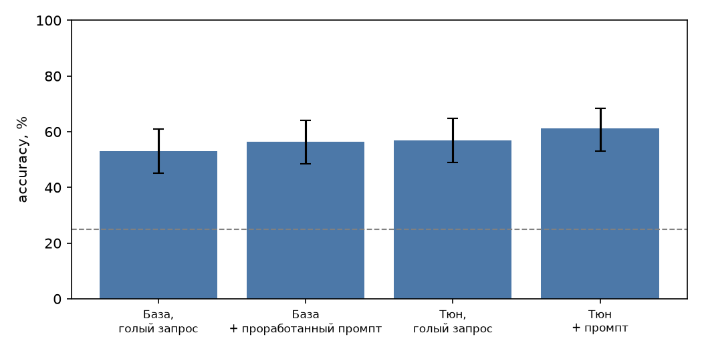
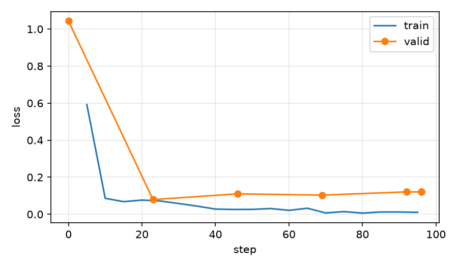

# Свой датасет: LoRA-тюн на вопросах теста «Mexamen»

Задача: ответ на тестовый вопрос о Мексике с выбором из 4 вариантов. Данные — `questions.json` из моего Android-приложения Mexamen (776 вопросов, испанский).
Дообучаем `Qwen/Qwen2.5-1.5B-Instruct` (LoRA) и сравниваем с той же моделью без тюнинга — с голым запросом и с проработанным промптом — на отложенном eval-наборе.

**Главный вывод:** тюн не обогнал проработанный промпт по точности (57.0% против 56.4%, разница в пределах шума), но дал то же качество на голом входе: формат 100%, вход в 4.2 раза короче. Знаний тюн не добавил, он выучил формат.

## Задача и что считается верным ответом

Вход — вопрос и варианты A–D, без инструкций:

```
¿Cuál es la capital de Baja California?
A) Tecate
B) Mexicali
C) Tijuana
D) Ensenada
```

Выход — ровно одна строка: `Respuesta: B) Mexicali`.

- **Верно** — выбрана буква правильного варианта. Для точности парсер лёгкий (`common.parse_answer`: «Respuesta: B», «B)», «the answer is B», либо в ответе встречается текст ровно одного варианта), чтобы базовую модель не штрафовать только за стиль.
- **Формат соблюдён (строго)** — весь ответ это `Respuesta: X) <текст варианта X>`, одна строка, текст совпадает с вариантом. Это отдельная метрика, именно её должен выучить тюн.

Почему такая задача: узкая, повторяющаяся, проверяется автоматически, без LLM-судьи. Объяснения (`explanation` в исходнике) в цель не берём: они написаны моделью, их не проверить автоматически, а при ручном просмотре в них встречаются выдумки.

## Данные и чистка (`prepare_data.py`)

Исходник: `data/questions.json`, 776 записей, 11 разделов. У 655 записей по 3 «настоящих» неверных варианта, у 119 только `syntheticDistractors` (сгенерированные), у 2 записей нестандартное число.

| Шаг | Что сделано | Осталось |
|---|---|---|
| Сборка | 4 варианта: правильный + 3 неверных. Настоящие неверные берутся первыми, синтетические только дополняют нехватку; дубли вариантов внутри вопроса убираются | 776 |
| Единый формат | Типографские кавычки → `"`, пробелы схлопнуты, убраны точка/`;`/`,`/`:` в конце, убрана замыкающая скобка `(…)`, первая буква заглавная — у **всех** вариантов одинаково | 776 |
| Длинные варианты | Выброшены записи, где любой вариант длиннее 140 символов (абзацы вместо ответа; при пороге 150 символов таких 63 правильных против 10 неверных — прямая подсказка по длине) | 712 |
| Дубли и почти-дубли | Пара считается дублем, если близки и вопрос, и ответ (Жаккар по символьным триграммам: вопрос ≥ 0.6, ответ ≥ 0.5; разные числа в ответах — не дубль). Удалено 4: `47` (= `27`), `89` (= `88`), `177` (= `112`), `423` (= `419`) | 708 |
| Ручной просмотр | 30 случайных примеров (`data/review_sample.md`) + список пар с близкими вопросами; удалено 6 (см. ниже) | **702** |

### Ручной просмотр 30 примеров

Просмотрел глазами; ответы проверял по собственным знаниям, источников не сверял. Результат:

- **Неверный или спорный ключ — 3 из 30:** #10 (первая credencial de elector: ключ 1990, но среди вариантов и 1992), #3 (богиня плодородия: Coatlicue vs Xochiquétzal/Tlazolteotl), #11 (год начала «новой эпохи» кино — вопрос мнения). Остальные 27 верны. Оценка доли проблемных ключей в исходнике — порядка 10% (при n = 30 доверительный интервал широкий: ~3–26%), поэтому в eval ожидаем небольшой шум в ключах.
- **Проблемы формата — 4 из 30:** висящая запятая в варианте (#18), к правильному ответу дописано второе предложение (#13, #28), «Rio» без акцента только в верном ответе при «Río» у остальных (#20).
- Из них удалены записи с ключом под вопросом (`564`, `153`, `688`) и `453` (акцент). Запятые чинятся автоматически. Дописанные предложения (33 правильных против 25 неверных вариантов) не режем: перекоса нет.
- Из списка пар с близкими вопросами удалены обе записи `764`/`765` — один вопрос про объекты ЮНЕСКО с конфликтующими ответами (35 и 27).

Все 6 причин — в `MANUAL_DROP` в `prepare_data.py`.

### Сплит без утечек

- Запись → группа: записи связываются, если вопросы похожи (триграммы ≥ 0.75, либо ≥ 0.6 при близких ответах). Группа целиком попадает в один сплит, поэтому переформулировка вопроса из eval не окажется в train.
- Eval стратифицирован по разделам (квоты пропорциональны), valid — тоже.
- Проверка: максимальное сходство вопроса из eval с любым вопросом из train/valid — **0.69** (шаблонные «¿Cuál es la capital de …?» / «¿Dónde se encuentra la zona arqueológica de …?» про другие объекты, ответы другие). Выше 0.75 — ни одного.

| | train | valid | eval | всего |
|---|---|---|---|---|
| Примеров | **505** | 48 | 149 | 702 |

### Разброс и перекосы

- **Раздел:** доля раздела во всех сплитах одинакова (от «Época prehispánica» 76/7/22 до «Estados y capitales» 23/2/7). Раздел «Estados y capitales» — шаблонные вопросы, их всего 32 (4.6%).
- **Положение правильного ответа:** буква выровнена принудительно — в train A/B/C/D = 127/126/126/126, в eval 37/37/37/38; порядок неверных вариантов случайный (seed 42). Иначе модель выучила бы «чаще B».
- **Длина:** в исходнике правильный вариант самый длинный в 41% вопросов (случайно было бы ~25%). После чистки: 33% (train 32%, eval 37%). Остаточный перекос есть. Поэтому в оценке отдельно считаю accuracy на вопросах, где ответ самый длинный, и на остальных, и привожу эталон «всегда самый длинный» (36.9% на eval). Тюн, который выигрывает только на «самых длинных», выучил подсказку, а не знания.
- **Формат вариантов:** до чистки в 12% правильных ответов был хвостовой `.` против 4% у неверных, скобка `(…)` в 13.7% против 3.4%, строчная первая буква 2.8% — после чистки 0%, 4.4% против 0.6%, 0%.

Полная статистика: [`data/report.json`](data/report.json).

## Замер без тюнинга и сравнение (`generate.py`, `score.py`)

Четыре конфигурации на одних и тех же 149 eval-вопросах, greedy, `max_new_tokens=128`:

| Конфиг | Вход |
|---|---|
| `base_plain` | вопрос + варианты, без инструкций |
| `base_prompted` | системный промпт с правилами и форматом + 3 few-shot примера (написаны вручную, в датасете их нет; `common.py`) |
| `tuned_plain` | тот же голый запрос, что в обучении |
| `tuned_prompted` | тюн + тот же промпт (проверка, не мешает ли промпт) |

Метрики: accuracy (95% интервал Уилсона), доля строго верного формата, доля неразобранных ответов, длина ответа; парный знаковый тест для сравнения конфигов (одни и те же вопросы).

## Обучение (`train_lora.py`)

| Параметр | Значение |
|---|---|
| Модель | `Qwen/Qwen2.5-1.5B-Instruct` |
| Метод | LoRA, r = 16, alpha = 32, dropout 0.05, все линейные слои |
| Данные | `data/train.jsonl` (505), валидация — `data/valid.jsonl` (48); лосс только по токенам ответа |
| Эпохи / батч / lr | 3 эпохи, 4 × 4 = 16, lr 2e-4 cosine |
| Железо | Google Colab, T4, fp16, пик памяти 5.8 GB |
| Время обучения | 223 с = 3.7 мин, 96 шагов оптимизатора, 54 313 токенов на эпоху (8 217 в лоссе) |
| Обучаемых параметров | 18 464 768 из 1 562 179 072 (1.2%) |
| Версии | transformers 5.21.0, peft 0.21.2, torch 2.11.0, seed 42 |

## Как воспроизвести

```bash
python prepare_data.py          # data/{train,valid,eval}.jsonl, review_sample.md, report.json
python build_notebook.py        # colab_mexamen.ipynb (с данными внутри)
# Colab: T4 -> Run all -> скачать results.zip -> распаковать в results/
python score.py results/        # comparison.md, answers.md, summary.json, accuracy.png, loss_curve.png
```

## Результаты

Адаптер (74 MB) и `results.zip` в репозиторий не включены; адаптер воспроизводится запуском ноутбука.

Eval: 149 вопросов, не входящих в обучение. Сырые ответы — `results/outputs/`, ответы бок о бок — `results/answers.md`, цифры — `results/comparison.md`, `results/summary.json`.



| Конфиг | Верно | Accuracy | 95% CI | Строгий формат | Не разобрано | Ср. токенов ответа |
|---|---|---|---|---|---|---|
| База, голый запрос | 79/149 | 53.0% | 45–61% | 0% | 3% | 106 |
| **База + проработанный промпт** (цифра, которую надо превзойти) | 84/149 | **56.4%** | 48–64% | 98% | 0% | 16.5 |
| **Тюн, голый запрос** | 85/149 | **57.0%** | 49–65% | 100% | 0% | 17.2 |
| Тюн + промпт | 91/149 | 61.1% | 53–68% | 99% | 0% | 17.4 |

Эталоны без модели: случайный выбор 25%, «всегда самый длинный вариант» 36.9%.

### Парные сравнения (одни и те же вопросы, точный знаковый тест)

| Сравнение | Только первый прав | Только второй прав | p |
|---|---|---|---|
| база голая → база с промптом | 15 | 20 | 0.50 |
| **база с промптом → тюн голый** | 20 | 21 | **1.00** |
| база голая → тюн голый | 8 | 14 | 0.29 |
| база с промптом → тюн с промптом | 12 | 19 | 0.28 |

### Что это значит

- **По точности тюн и промпт неразличимы.** 57.0% против 56.4%, расходящихся пар 20 против 21. Ни одно из сравнений не значимо: на 149 вопросах различимы разницы порядка 10 п.п., а все четыре конфига лежат в диапазоне 53–61%. Тюн + промпт выше всех (61.1%), но его отрыв от промпта (+4.7 п.п., p = 0.28) тоже в пределах шума. Один прогон, один seed, greedy.
- **Что тюн дал по делу — формат и цену запроса.** Голый тюн отвечает строго по формату в 100% случаев, а голая база в 0% и пишет в среднем 106 токенов против 17. Проработанный промпт даёт 98%, но с ним вход в 4.2 раза длиннее: 387 токенов против 93 на запрос (по токенайзеру Qwen2.5). То же качество достигается без промпта и без few-shot.
- **Знаний тюн не добавил.** В train 505 других фактов, в eval — вопросы про другие. Падение val loss 1.04 → 0.12, скорее всего, в основном отражает выученный формат `Respuesta: X) …` (токены формата предсказываются почти точно), а не знания.
- **Смещение базы по буквам.** Базовая модель с промптом выбирала D всего 23 раза при 37 верных D в eval (A 44, B 43, C 39). У тюна ответы по буквам ровнее: 37 / 33 / 39 / 40.
- **Подсказка по длине.** Когда верный вариант самый длинный, все конфиги отвечают лучше (база с промптом 71%, голый тюн 75%, тюн с промптом 80%), когда не самый длинный — 44–50%. Тюн на длинных поднял точность на 4 п.п., на остальных не изменил (47% против 48%), то есть подсказку по длине он выучил не сильнее базы. Но на «самых длинных» всё равно заметно лучше, чем на остальных, как и база.
- **По разделам** выводов не делаю: в каждом 7–22 вопроса. Замечу только, что в «Civismo» было 10/13 у базы с промптом и 5/13 у тюна, а в «Conquista» 9/12 и 6/12. Это на уровне шума, но причину я не выяснял.

### Переобучение



Val loss: 1.043 (до обучения) → **0.079 на шаге 23** → 0.110 → 0.103 → 0.121 (конец). Train loss к концу 0.01. После шага 23 (около 0.75 эпохи) val loss растёт при падающем train loss — переобучение. Три эпохи на 505 примерах — с запасом, вероятно, хватило бы одной (проверять не стал). Лучшую по val loss точку я не сохранял, оценивался финальный адаптер.

### Оговорки

- **Голая база (53.0%).** 84 из 149 ответов упёрлись в лимит 128 токенов: модель многословна. Верный вариант я искал мягким парсером (буква либо текст ровно одного варианта), 5 ответов (3%) не разобраны и засчитаны неверными. Реальная точность голой базы может быть чуть выше.
- **Ключи в данных.** В ручной выборке 3 из 30 ключей были спорными. Спорные записи, найденные в просмотре, я убрал, но остальные ~670 не проверял, так что часть eval-ключей может быть неверной. Это шумит одинаково для всех конфигов.
- **Малый eval.** Для различения 56% и 57% нужны тысячи вопросов, а в датасете их всего 702.
- **Что делать дальше (я не делал):** одна эпоха или ранняя остановка по val loss; модель побольше (3B/7B), у которой есть что «открывать» в знаниях; расширить датасет вопросами по тем же фактам в другой форме.
